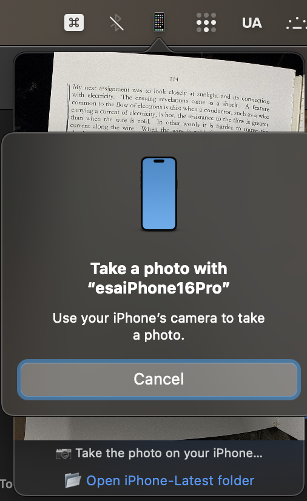

# iPhoneLatest 📱

**Take a photo with your iPhone, drag it into any chat.**

> **Standalone public repo (canonical): [esaruoho/apple-continuity-camera-photographer](https://github.com/esaruoho/apple-continuity-camera-photographer)** (`~/work/apple-continuity-camera-photographer`). It adds `install-mcp.sh`, which registers the MCP server with every agent CLI. The MCP registrations on this Mac point at the standalone copy. Keep both in sync; the standalone wins if they diverge.

A tiny Apple-native menu-bar app. One click on 📱 opens the iPhone's camera. Take the shot, tap **Use Photo**, and it appears as a thumbnail under the icon, ready to drag into Terminal, Claude, Mail or Messages.

No AirDrop, no emailing yourself, no iCloud wait, no cable needed.



## Why

Showing an AI agent something on the desk used to mean: take the photo, iMessage or email it to yourself, find it, drag it into the chat. Now:

1. **Click 📱.** The iPhone is armed immediately. Shoot, tap **Use Photo**, and drag the thumbnail into Claude, Codex, Gemini or anywhere else. It's also saved to `~/Pictures/iPhone-Latest/`.
2. **Tell the agent "take a photo".** The MCP tool arms the iPhone. Shoot, tap **Use Photo**, and the photo goes straight into the chat, with no dragging and the context intact.

It fits naturally with USB tethering: the same cable gives the laptop internet and charges the phone. The photos themselves travel over Continuity Camera, so no cable is needed for them.

## Use

| Action | Result |
|---|---|
| Click **📱** | The iPhone camera opens. Shoot, tap **Use Photo**, and the thumbnail appears. |
| **Drag** the thumbnail | Drops the JPEG into any app or chat. |
| Click **📱** again, thumbnail open | Closes it. |
| **📂 Open iPhone-Latest folder** | Every photo you've taken, in Finder. |
| **Right-click 📱** | Help / Support · Open folder · **Open at Login** · Quit |

Every photo is kept (never overwritten) in `~/Pictures/iPhone-Latest/Continuity-<yyyyMMdd-HHmmss>.jpg`.

## Claude can ask for a photo

- `bin/iphone-snap` opens `iphonelatest://take`, waits for your shot, and prints the JPEG path. A Claude session then Reads the path and sees the photo.
- MCP tool **`take_iphone_photo`** (`bin/iphone-snap-mcp`, dependency-free stdio server) is available in every Claude Code session:
  `claude mcp add iphone -s user -- ~/work/apple/bin/iphone-snap-mcp`

### Other agents (same server, one line each — all registered on this Mac 2026-11-10)

| Agent | Register | Config file |
|---|---|---|
| Claude Code | `claude mcp add iphone -s user -- ~/work/apple/bin/iphone-snap-mcp` | `~/.claude.json` |
| Codex CLI | `codex mcp add iphone -- ~/work/apple/bin/iphone-snap-mcp` | `~/.codex/config.toml` |
| Gemini CLI | `gemini mcp add -s user iphone ~/work/apple/bin/iphone-snap-mcp` | `~/.gemini/settings.json` |
| Copilot CLI | `copilot mcp add iphone -- ~/work/apple/bin/iphone-snap-mcp` | `~/.copilot/mcp-config.json` |
| Antigravity (`agy`) | `agy mcp add iphone ~/work/apple/bin/iphone-snap-mcp` | managed by `agy mcp` |

Global instructions telling each agent to *use* the tool when seeing would help: `~/.claude/CLAUDE.md`, `~/.codex/AGENTS.md`, `~/.gemini/GEMINI.md`, `~/.copilot/copilot-instructions.md`. Pre-approved in Claude Code (`mcp__iphone__take_iphone_photo` in `~/.claude/settings.json`) and trusted in Gemini (`--trust`).

No MCP? Any agent with a shell can run `bin/iphone-snap` and open the printed path.

## Requirements

- macOS 13+ and an iPhone on the **same Apple ID**, with **Wi-Fi + Bluetooth** on (Continuity Camera).

## Install / build

```bash
iphone-latest/build.sh      # compile → sign → /Applications/iPhoneLatest.app → launch
```

On first launch it registers itself to **Open at Login** (Apple's `SMAppService`). Toggle it from right-click 📱 ▸ Open at Login, or in System Settings ▸ General ▸ Login Items.

## How it works

Continuity Camera through Apple's own "Import from iPhone ▸ Take Photo" mechanism, the same one Finder, Notes and TextEdit use:

- `NSMenuItem.importFromDeviceIdentifier` lives in the app's **main menu**. A probe showed AppKit only activates it there; pop-up menus stay grey.
- AppKit fills in the device submenu only after the menu has been opened once, so the first click opens it and cancels it after 0.4 s, then fires **Take Photo** directly.
- The photo comes back through `NSServicesMenuRequestor.readSelection(from:)`, gets saved as JPEG and shown as a draggable `NSImageView`. The drag starts only after the mouse actually moves.

## Why not the USB cable?

We tried that first, and it's documented in [`FINDINGS.md`](FINDINGS.md). Over USB, iOS publishes new photos to ImageCaptureCore late and unreliably: one at a time, 15–60 s after the shot, with stale catalogs after reopening the session. Continuity Camera returns the shot in a few seconds, every time.

## Files

- `main.swift` — the app (~240 lines)
- `build.sh` — build + install
- `make-icon.swift` — renders `AppIcon.icns`
- `FINDINGS.md` — the USB investigation
- Report card: [`../features/iphone-latest.feature`](../features/iphone-latest.feature)
- Shared Help + donate panel: [`../shared/SupportHelp.swift`](../shared/SupportHelp.swift)
